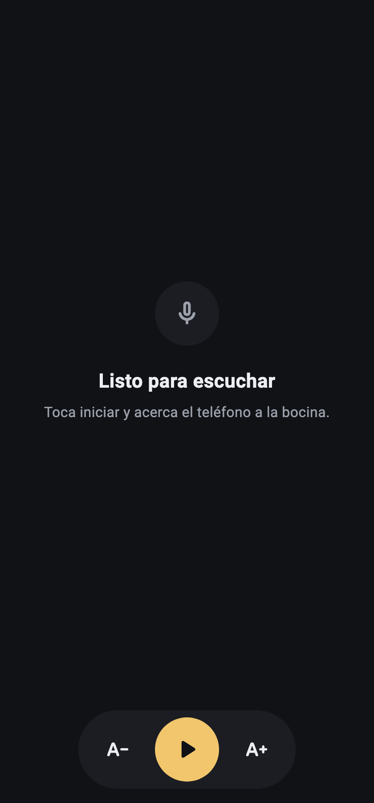
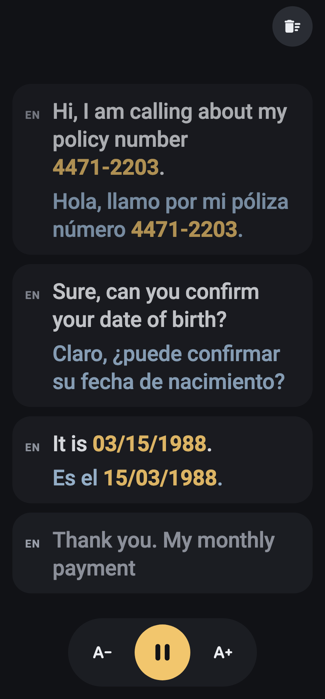
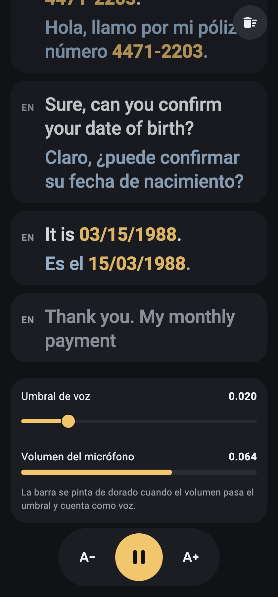

# Live Captions

Live captions with translation for call-center agents. The phone sits next
to the PC speaker, listens through its microphone, and shows what is being
said together with its translation, full screen.

Everything runs on the phone. The internet is only used the first time, to
download the speech and translation models. No audio or text is ever saved.

Android only.

## Screenshots

<p>
  
  
  
</p>

From left to right: ready to listen, captions with their translation (the
gray one is still being spoken), and the hidden panel to tune the voice
threshold, opened with a long press on the captions.

## Run it

```
flutter run --release
```

## Check it

```
flutter analyze --no-fatal-infos
flutter test
```

## Build an APK

```
flutter build apk --release
```
